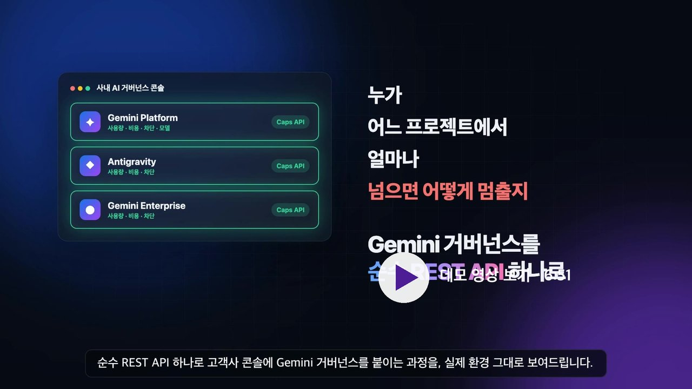

# Hub-and-Spoke GCP AI Usage & Model Budget Dashboard

[`gcp-ai-usage-caps-api`](https://github.com/ldu1225/gcp-ai-usage-caps-api/tree/main) (`v1.3.0`)를 백엔드로 사용하여 **허브(`duleetest`)** 와 **스포크(`dulee-ai-test`)** 프로젝트의 Google Cloud AI(**Gemini Platform**, **Antigravity**, **Gemini Enterprise**) 사용량을 **유저별·모델별로 트래킹**하고, **예산 상한 초과 시 IAM Deny v2로 자동/수동 차단**하는 경량 BFF 대시보드입니다.

외부 Python/JS 패키지 의존성 없이 Python 3.12 표준 라이브러리와 모던 HTML/CSS/Vanilla JS만으로 동작합니다.

## 데모 영상 (실환경 · 6분 51초)

[](https://ai-control-plane-hub-484712896449.us-central1.run.app/api/#featured-film-title)

아키텍처 → Caps API 명세서(사용량·비용, 한도·차단, 그룹, 모델 통제, 쿼터, 보안) → 이 콘솔 투어 → 즉시 차단 · 예산 초과 자동 차단 · 모델 위반 · 조직 정책 영향도 미리보기 · 비용과 감사 로그. 테스트 사용자의 실제 Gemini 호출이 IAM Deny로 403 차단되고 다시 풀리는 과정을 그대로 담았습니다. 한국어 내레이션과 자막이 포함되어 있습니다.

- 영상 재생: [엔게이지먼트 허브 · API 탭](https://ai-control-plane-hub-484712896449.us-central1.run.app/api/#featured-film-title)
- MP4 직접 받기: [gemini-governance-rest-api-demo.mp4](https://ai-control-plane-hub-484712896449.us-central1.run.app/media/video/gemini-governance-rest-api-demo.cddfca756c.mp4) (72 MB, GitHub 100 MB 파일 제한 때문에 저장소 대신 허브에서 제공합니다.)

## 접속 URL

| 환경 | URL |
|---|---|
| Cloud Run (`duleetest`, `asia-northeast3`) | https://caps-dashboard-484712896449.asia-northeast3.run.app |
| 로컬 | `http://localhost:8090` (`python3 caps-dashboard/server.py`) |

로그인 비밀번호는 로컬 콘솔과 같은 관리자 비밀번호입니다(`deploy.sh`가 `.local_admin_hash`를 Secret Manager로 옮깁니다).


## 주요 기능

1. **개요 & 유저 트래킹 (`duleetest` Hub · `dulee-ai-test` Spoke)**
   - 프로젝트별 필터(`전체`, `duleetest (Hub)`, `dulee-ai-test (Spoke)`), 기간 선택, 실시간 로그 병합(`fresh`) 지원
   - 유저별 요청 수, 토큰, 공식 Cloud Billing Catalog SKU 추정 비용, Hub/Spoke 분리 비용, 예산 소진율, 상태(`active`/`over_cap`/`suspended`/`blocked`) 조회
   - 유저 상세 모달: 일별 사용량 SVG 차트, 프로젝트별/모델별 상세 내역, 적용 중인 모델 규칙 확인
   - 유저별 개별 예산 캡(`PUT /v1/caps/users/{email}` — 합산 또는 Hub/Spoke 프로젝트별 상한) 및 즉시 차단/해제(`POST /v1/users/{email}/block|unblock`)
2. **모델 예산 & 자동 차단**
   - 전역/유저별 모델 예산 규칙(`PUT /v1/model-rules/default`, `PUT /v1/users/{email}/model-rules`): 모델 ID 또는 패턴(`gemini-4-argon`, `claude-*`, `*`)별로 **월 예산($ USD)**, 토큰, RPM 상한 지정 및 초과 시 `block_service`(IAM Deny v2 자동 차단) 집행
   - `POST /v1/model-rules/evaluate` 기반 Dry-Run 미리보기 및 즉시 평가·차단
   - 실시간 Model Garden 카탈로그 + 로그 관측 모델 + 공식 SKU 단가 조회 및 프로젝트별 Org Policy(`constraints/vertexai.allowedModels`) 허용/차단(Dry-Run 포함)
3. **허브/스포크 정책**
   - 전역 지출 캡 정책(`PUT /v1/caps/policy`) 및 Hub/Spoke별 기본 상한(`project_defaults`)
   - 안전 게이트 G1–G7 포함 지출 캡 집행(`POST /v1/caps/enforce`)
   - `duleetest`(Hub) / `dulee-ai-test`(Spoke)별 월간 프로젝트 하드캡 및 Gemini Platform 추론 요청 로그 상태 조회·활성화
4. **위반 & 감사 로그**
   - 모델 예산/정책 위반 이벤트(`GET /v1/model-violations`) 및 거버넌스 감사 로그(`GET /v1/audit-logs`)

## 로컬 실행 방법 (고객사 포털 입장 · 100% REST API 전용)

이 대시보드는 **GCP SDK, `gcloud`, BigQuery, GCS, IAM API를 일절 직접 호출하지 않으며**, 오직 `gcp-ai-usage-caps-api`의 REST 엔드포인트(`/v1/*`)와 발급받은 Scoped M2M API Key(`Authorization: Bearer gcpai_...`)만으로 동작합니다.

기본적으로 `127.0.0.1:8090`에 바인딩됩니다. `caps-dashboard/.env`(gitignored) 또는 환경 변수에 `CAPS_API_BASE_URL`과 `CAPS_API_KEY`를 설정한 뒤 실행합니다.

```bash
CAPS_API_BASE_URL="https://gcp-ai-usage-caps-api-484712896449.asia-northeast3.run.app" \
CAPS_API_KEY="gcpai_..." \
HUB_PROJECT="duleetest" \
SPOKE_PROJECTS="dulee-ai-test" \
python3 caps-dashboard/server.py
```

또는 `caps-dashboard/.env` 파일에 설정해 둔 경우:

```bash
python3 caps-dashboard/server.py
```

브라우저에서 **`http://localhost:8090`** 으로 접속해 최초 로컬 관리자 비밀번호(12자 이상)를 설정하면 바로 `duleetest`와 `dulee-ai-test`를 제어할 수 있습니다.

## Cloud Run 배포

명령 한 번으로 배포합니다. `caps-dashboard/.env`의 `CAPS_API_BASE_URL`·`CAPS_API_KEY`·`HUB_PROJECT`·`SPOKE_PROJECTS`와 로컬 관리자 비밀번호 해시(`.local_admin_hash`)를 읽습니다.

```bash
bash caps-dashboard/deploy.sh          # PROJECT_ID=duleetest REGION=asia-northeast3 SERVICE_NAME=caps-dashboard (기본값)
```

스크립트가 하는 일:

1. Cloud Run · Cloud Build · Artifact Registry · Secret Manager API 활성화
2. 전용 서비스 계정 `caps-dashboard-sa` 생성. 권한은 아래 시크릿 3개 읽기뿐입니다(콘솔은 Caps REST API만 호출하고 Google Cloud API를 직접 부르지 않습니다).
3. Secret Manager에 `caps-dashboard-api-key`(`CAPS_API_KEY`), `caps-dashboard-session-secret`(`DASHBOARD_SESSION_SECRET`, 최초 1회 생성), `caps-dashboard-admin-hash`(`DASHBOARD_ADMIN_PASSWORD_HASH`) 저장. 값이 바뀐 경우에만 새 버전을 추가합니다.
4. `gcloud run deploy --source`로 빌드·배포. `.gcloudignore`가 `.env`, `.local_admin_hash`를 업로드에서 제외합니다.

다른 비밀번호를 쓰려면 해시를 만들어 `DASHBOARD_ADMIN_PASSWORD_HASH`로 넘깁니다.

```bash
# scrypt 비밀번호 해시 생성 예시 (로컬에서 1회 실행 후 Secret Manager에 저장)
python3 -c 'import getpass, sys; sys.path.insert(0, "caps-dashboard"); from app.security import hash_password; print(hash_password(getpass.getpass("Admin password (12+ chars): ")))'
```

## 테스트 실행

```bash
python3 -m unittest discover -s caps-dashboard/tests -v
```

## 2026-11 리디자인 (영상 촬영용 프리미엄 UI)

- **API 호출 보기 (API Call Inspector)**: 헤더의 `API 호출 보기` 버튼을 누르면, BFF가 화면 동작마다 호출한 `gcp-ai-usage-caps-api` `/v1/*` 요청이 실시간으로 표시됩니다(메서드, 경로, 상태, 지연, 요청 본문, 응답 일부). 호출 기록은 세션별 링 버퍼(`GET /api/_trace?since=`)에 저장되며 Authorization 헤더와 API 키는 기록하지 않습니다.
- **사용자 드릴다운**: Hub/Spoke별 및 모델별 비용, 일별 추이, 한도 게이지, 감사 이력, IAM Deny 집행 상태(`propagating` → `enforced`)를 경과 시간과 함께 실시간으로 추적합니다(`GET /api/user/cap?fresh=true` 폴링).
- **비용 탐색기** (`GET /api/costs`), **모델 거버넌스** (Org Policy Dry-run → 적용, 모델 규칙 평가), **정책 & G1–G7**, **감사 & 위반** 탭.
- 개요의 **서비스 거버넌스 커버리지** 카드는 Caps API가 통제하는 Google Cloud AI 서비스(Gemini Platform · Antigravity · Gemini Enterprise)를 보여줍니다. 화면의 모든 수치는 Caps API에서 받은 값입니다.
- Playwright 촬영용 selector 목록: [`UI_IDS.md`](UI_IDS.md)
- 로컬 테스트 인스턴스: `PORT=8097 DASHBOARD_ADMIN_PASSWORD='<12자 이상>' python3 caps-dashboard/server.py`. 이 경우 비밀번호는 메모리에서만 해시되며 `.local_admin_hash`를 변경하지 않습니다.
